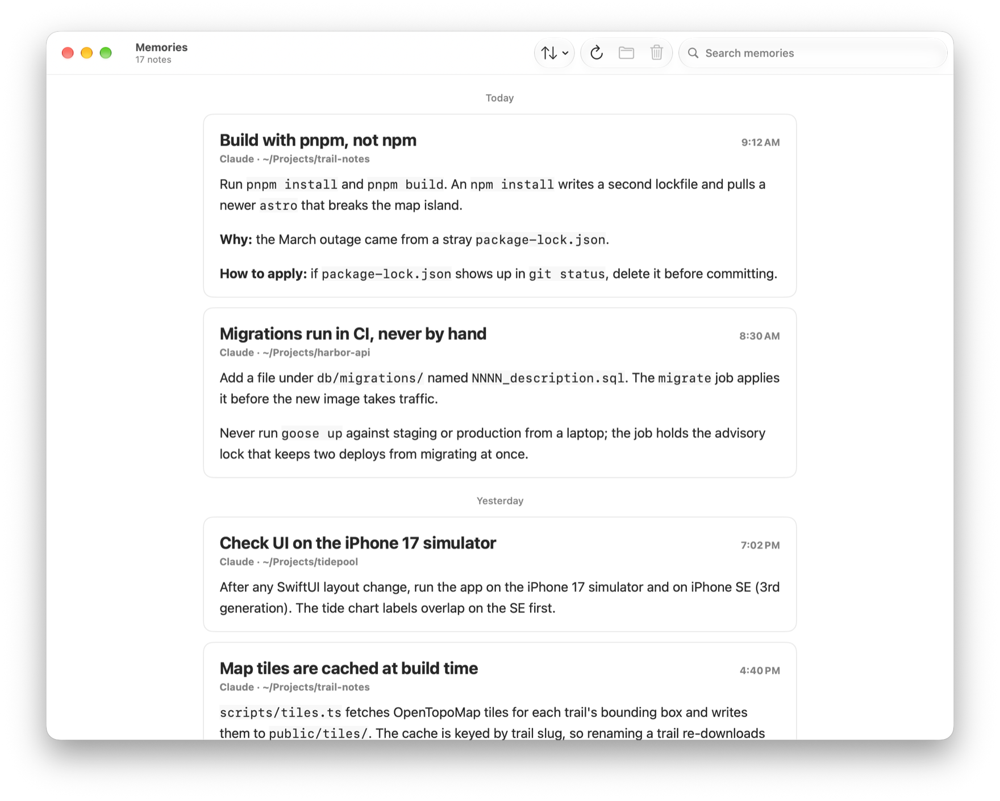
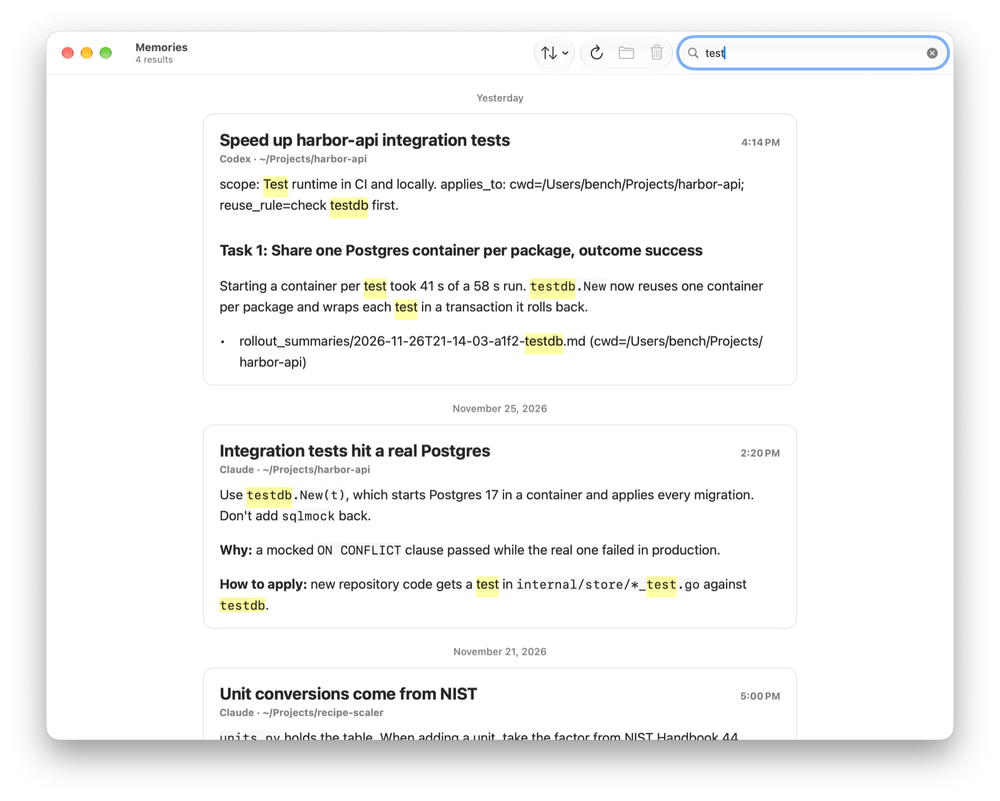

# MemWhole

MemWhole searches the memory notes Claude Code and Codex keep about your projects. It's a macOS app and a command-line tool, and it reads and indexes everything locally.

<picture>
  <source media="(prefers-color-scheme: dark)" srcset="docs/stream-dark.png">
  
</picture>

## Features

- Indexes Claude's `~/.claude/projects/*/memory/**/*.md` and Codex's `~/.codex/memories` into a SQLite full-text index. Each update reads only the files that changed.
- Shows every note as a card, newest first. Each card names its source (Claude or Codex) and project.
- Highlights matches as you type. ⌘G steps through them, and the toolbar sorts by date or best match.
- Masks values that look like API keys, tokens and passwords before anything is stored.
- Moves a Claude note to the Trash and deletes its pointer from the project's `MEMORY.md`. Codex notes are read-only.
- The `memwhole` command searches the same index. It filters by project, source or date and can print JSON.

<picture>
  <source media="(prefers-color-scheme: dark)" srcset="docs/search-dark.png">
  
</picture>

## Requirements

- macOS 15 or later
- Xcode 16 or later
- [XcodeGen](https://github.com/yonaskolb/XcodeGen) to build the app (`brew install xcodegen`)

## Install

The app:

```bash
scripts/install-app.sh
```

This makes a Release build and installs it in `/Applications`. The app finds `~/.claude` and `~/.codex/memories` without setup and indexes them at launch. A blank search lists every note, ⌘F focuses the search field and ⌘R updates the index.

The command-line tool:

```bash
swift build -c release
```

The binary is `.build/release/memwhole`.

## Usage

```bash
memwhole index                       # update the index; --full rebuilds it
memwhole search release build --project MemWhole
memwhole stats
```

- Words are ANDed, and the last word matches as a prefix. `--raw` passes FTS5 syntax through (`"exact phrase"`, `OR`, `NOT`).
- Filters: `--project TEXT`, `--source claude|codex`, `--since 2026-10-01` or `--since 7d`, `--limit N`.
- Results are newest first. `--sort relevance` ranks by match quality, weighting title matches above body matches.
- `--json` prints machine-readable hits.

## Configuration

The index lives at `~/Library/Application Support/MemWhole/index.sqlite`. Pass `--db PATH` or set `$MEMWHOLE_DB` to use another file.

## Build and test

```bash
swift test
xcodegen --spec App/project.yml     # after adding or removing app files
open App/MemWhole.xcodeproj
```

How the index, parsing and app fit together is in [ARCHITECTURE.md](ARCHITECTURE.md).
